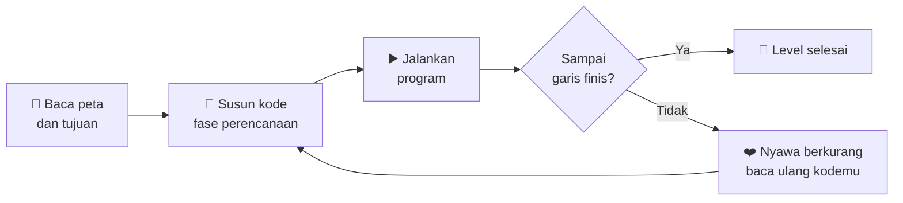

<!-- ===================== HEADER ===================== -->
<div align="center">


<!--
  OPSIONAL: ganti banner dengan screenshot / GIF gameplay sendiri.
  1. Simpan gambar di assets/banner.png (rasio lebar, mis. 1600x400)
  2. Hapus  capsule-render di atas, lalu pakai:
  
-->

<a href="https://git.io/typing-svg">
  
</a>

<br/><br/>

<a href="https://github.com/FadhillahM-N-H/ARIA-Unchosen-Steps/releases/latest">
  
</a>

<br/><br/>


</div>

---

## 🛰️ Transmisi Masuk

> **`NEXUS-7 // STATUS: LOCKDOWN`**
> Semua pintu terkunci. Unit **ARIA** masih menyala, tetapi tidak bisa mengambil keputusan sendiri.
> Satu-satunya cara menggerakkannya adalah **kode yang kamu tulis**.

**ARIA: Unchosen Steps** adalah *programming puzzle game* 3D tempat kamu berperan sebagai teknisi yang mengendalikan ARIA. Kamu menyusun instruksi, menjalankannya, lalu melihat sendiri apa yang terjadi. Dari situ, konsep dasar **Python** dipelajari lewat konsekuensi nyata di dalam level, bukan lewat hafalan.

> 🎓 Dibuat sebagai tugas UAS mata kuliah **Pemrograman Game** sekaligus bahan proposal Tugas Akhir.

---

## ⬇️ Unduh dan Mainkan

1. Buka halaman **[Releases](https://github.com/FadhillahM-N-H/ARIA-Unchosen-Steps/releases/latest)** dan unduh file `.zip` terbaru.
2. **Ekstrak seluruh isi zip** ke satu folder. Jangan menjalankan game langsung dari dalam zip.
3. Buka folder hasil ekstrak, lalu jalankan file **`.exe`** game.
4. Mainkan. Bila baru pertama kali, mulai dari level pengantar.

> 💡 Jika Windows menampilkan peringatan *"Windows protected your PC"*, klik **More info ▸ Run anyway**. Peringatan ini muncul karena game belum bertanda tangan digital, bukan karena ada masalah.

---

## 🔁 Siklus Bermain



1. **Pilih level** dari menu.
2. **Pelajari peta** dan temukan garis finis.
3. **Susun instruksi** untuk ARIA pada fase perencanaan.
4. **Jalankan** dan amati gerakannya.
5. **Perbaiki** kodemu bila gagal, ingat nyawa terbatas.

---

## ✨ Fitur

| | Fitur | Keterangan |
|---|---|---|
| 🧩 | **Dua mode kode** | Mulai dari blok seret-dan-lepas, lalu naik ke Mode Teks dengan sintaks Python sungguhan |
| 🧠 | **Belajar bertahap** | Setiap level memperkenalkan satu ide baru, tanpa lompatan besar |
| 🗺️ | **8 level, 22 stage** | Level 1–7 masing-masing 3 stage, Level 8 adalah stage penutup, ditambah level pengantar |
| ❤️ | **Sistem nyawa** | Salah langkah ada harganya, jadi pemain terdorong membaca sebelum menjalankan |
| 💡 | **Catatan Dea** | Petunjuk bertahap yang menuntun tanpa langsung memberi jawaban |
| 🎬 | **Tutorial kontekstual** | Level pengantar untuk kontrol dasar, plus tutorial mini setiap ada cara input baru |
| 🎨 | **Gaya HOLLOW ARRAY** | Hitam matte dan gunmetal, bentuk *hard-surface* low-poly, merah hanya untuk peringatan |

---

## 🐍 Konsep Python yang Dipelajari

| Tahap | Konsep | Contoh |
|---|---|---|
| Awal | Urutan perintah | Memerintah ARIA langkah demi langkah dengan blok |
| Stage 2-3 | **Mode Teks** | Mengetik perintah sendiri |
| Stage 3-1 | **Parameter** | `move(3)` |
| Stage 3-2 | **Variabel dan rumus** | `data = read_terminal()` lalu `data + 5` |
| Stage 4-1 | **Kondisi `if`** | Memeriksa ubin dengan `check_anomaly` |
| Stage 4-2 | **`elif`** | Cabang kondisi tambahan |
| Stage 4-3 | **Indentasi** | Menempatkan baris di dalam blok yang benar |
| Level lanjut | **Perulangan** | Mengulang pola langkah |

Gaya kode di dalam game:

```python
data = read_terminal()
password = data + 5
move(3)
```

---

<details>
<summary><b>⚠️ Catatan Versi</b></summary>

<br/>

- 🧪 Game belum melalui playtest dengan pemain lain, jadi masukan sangat dihargai.
- ✍️ Di Mode Teks, tip "garis merah" bisa muncul saat kamu masih mengetik.
- 🧱 Jika dinding tampak pekat (tidak transparan) di perangkatmu, tolong laporkan lewat [Issues](https://github.com/FadhillahM-N-H/ARIA-Unchosen-Steps/issues).

</details>

---

## 🙏 Kredit dan Aset

- **Model 3D lingkungan, musuh, dan unit ARIA:** dibuat sendiri di Blender.
- **Model SentryRobot:** paket *Light Hearted Tech* (aset pihak ketiga).
- **Font** (lisensi SIL OFL): Barlow, Barlow Condensed, IBM Plex Mono, JetBrains Mono, Rajdhani.
- **Dibuat dengan:** Unity 6000.5.10f1 · Universal RP · Cinemachine · Input System · UI Toolkit.

---

## 🧭 Rencana Pengembangan

- [ ] Reset Progres di menu Pengaturan
- [ ] Optimasi performa dan model 3D
- [ ] Bahasa Inggris
- [ ] Level boss (di luar cakupan v1.0)

---

## 🐞 Menemukan Bug?

Buka tab **[Issues](https://github.com/FadhillahM-N-H/ARIA-Unchosen-Steps/issues)** lalu ceritakan apa yang terjadi, di level dan stage berapa, serta spesifikasi perangkatmu. Screenshot sangat membantu.

---

## 👤 Pembuat

<div align="center">

**Fadhillah Muhammad Nur Hafiz**
D4 Manajemen Informatika · Fakultas Vokasi · Universitas Negeri Surabaya
*Solo developer · 1 September 2026 → build v1.0, 1 November 2026*

<a href="https://github.com/FadhillahM-N-H"></a>

</div>

---

## 📄 Hak Penggunaan

© 2026 Fadhillah Muhammad Nur Hafiz. Game ini dibagikan untuk dimainkan dan dinilai sebagai karya akademik. Mohon tidak mendistribusikan ulang atau menjualnya tanpa izin.

<!-- ===================== FOOTER ===================== -->
<div align="center">
  
</div>
